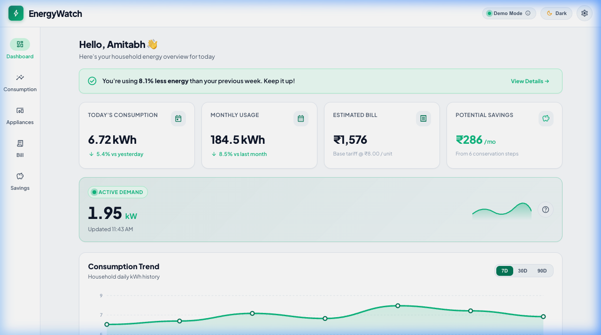
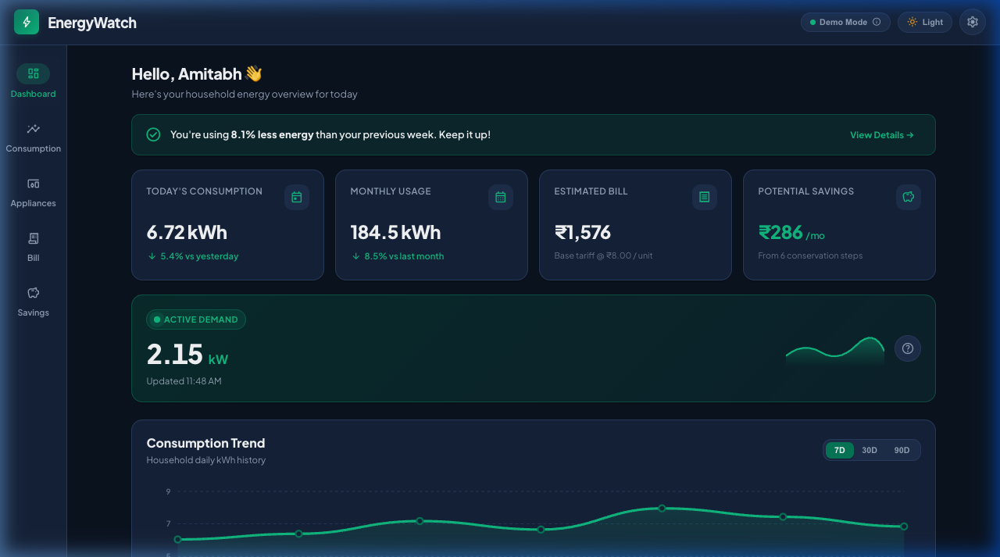
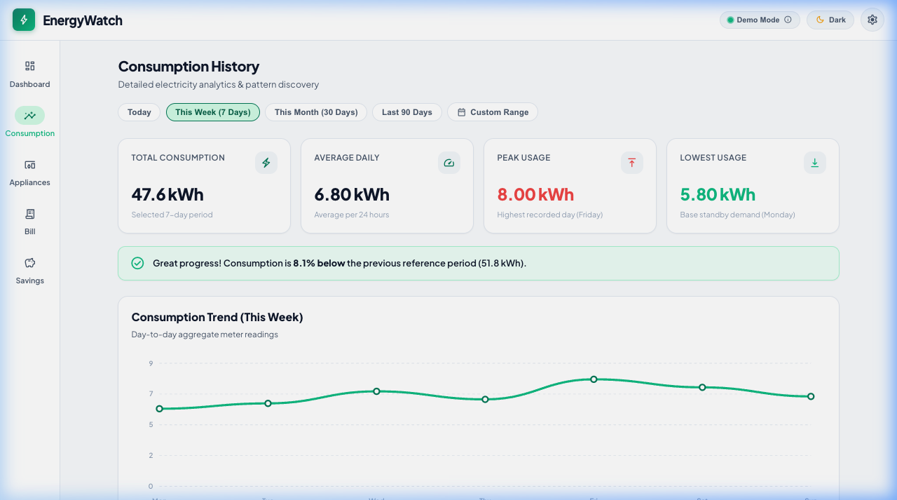
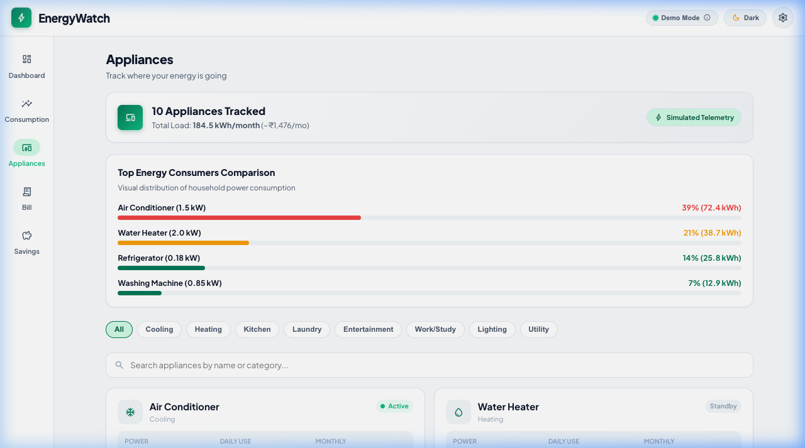
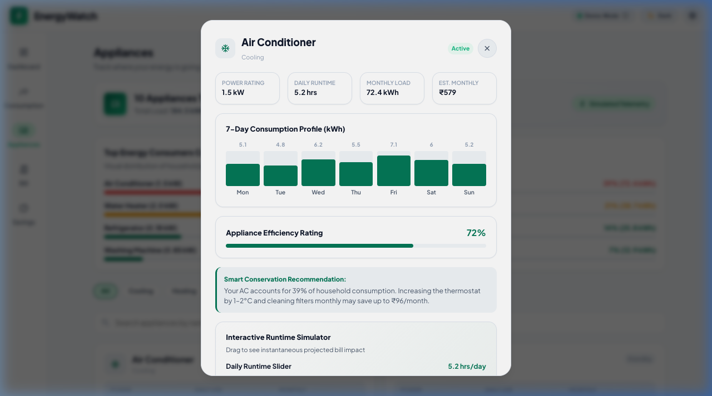
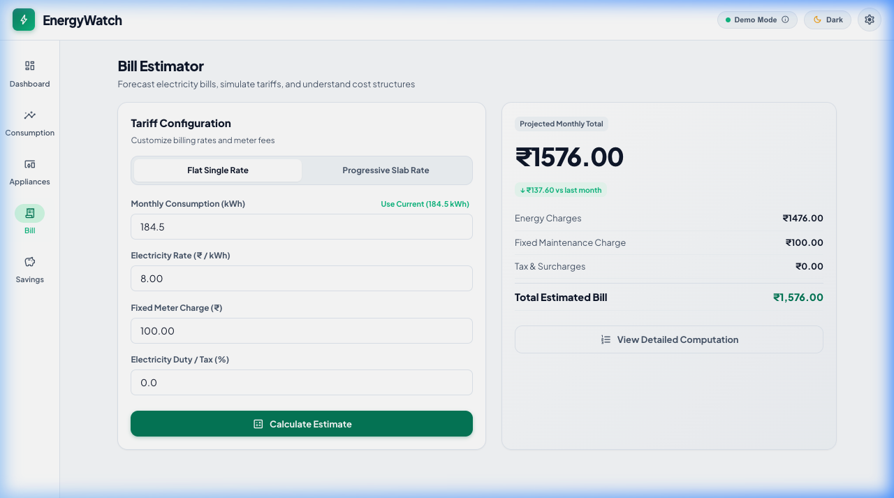
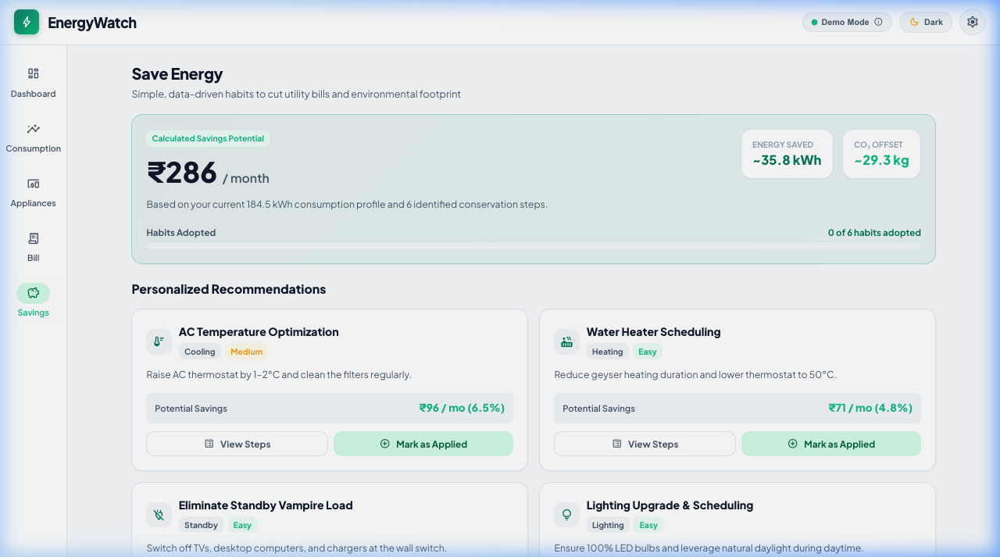

# ⚡ EnergyWatch — Smart Home Energy Monitoring & Bill Forecasting Dashboard

[](https://flutter.dev)
[](https://dart.dev)
[](https://developer.mozilla.org/en-US/docs/Web/HTML)
[](https://developer.mozilla.org/en-US/docs/Web/CSS)
[](https://developer.mozilla.org/en-US/docs/Web/JavaScript)
[](https://m3.material.io)

**EnergyWatch** is a modern, presentation-ready energy management platform available as both a **Material 3 Flutter mobile application** and an **ultra-lightweight Plain HTML5/CSS3/JavaScript responsive web dashboard**.

It provides real-time active demand telemetry, appliance-level tracking, progressive slab tariff forecasting, and data-driven conservation insights.

> **Presentation Note**: This application is currently running on a **calibrated simulation data layer** (monthly total: **184.5 kWh**, baseline bill: **₹1,576**). The architecture implements the **Repository Pattern** with an abstract `EnergyDataSource` contract, so physical IoT hardware (ESP32, CT clamp sensors, PZEM-004T, MQTT, or REST APIs) can seamlessly replace mock data with **zero code modifications to the UI**.

---

## 📸 Visual Showcase

### 1. Central Executive Dashboard (Light & Dark Themes)
| Light Mode Dashboard | High-Contrast Dark Mode |
| :---: | :---: |
|  |  |

### 2. Deep Consumption Analytics & Appliance Tracking
| 24-Hour Load Profile & Peak Hour Highlighting | 10 Tracked Household Appliances |
| :---: | :---: |
|  |  |

### 3. Interactive Runtime Simulator & Dynamic Bill Estimator
| Interactive Runtime Slider (+/- Projected Savings) | Progressive Slab Tariff Calculation |
| :---: | :---: |
|  |  |

### 4. Energy Conservation Habits & Carbon Reduction


---

## ⚡ Core Problem & Solution

Traditional utility billing arrives weeks after electricity is consumed, leaving homeowners without visibility into:
1. **Instantaneous demand**: How much power active appliances are drawing right now.
2. **Appliance disaggregation**: Which specific appliances drive the bulk of peak charges.
3. **Realistic bill forecasts**: End-of-month electricity costs before the billing cycle closes.
4. **Actionable habits**: Specific, measurable steps to lower expenses and carbon footprint.

**EnergyWatch** solves this through:
- **Live Active Demand Monitor**: Simulated real-time load (`1.84 kW`, drifting within realistic 1.70–2.15 kW residential limits).
- **24-Hour Load Profile**: Bar chart flagging residential evening peak hours (6:00 PM – 10:00 PM) in amber warnings.
- **10 Tracked Household Appliances**: Power ratings, daily runtimes, monthly kWh, and percentage share.
- **Interactive Runtime Simulator**: Drag the daily runtime slider (0–24 hrs) on any appliance to see real-time recalculation of projected monthly kWh and bill impact (+/- ₹).
- **Dual Tariff Bill Estimator**: Calculate bills under both **Flat Single Rate** and **Progressive Tiered Slab Billing**.
- **Actionable Savings Engine**: 6 prioritized habits yielding **₹286/month potential savings** and **~29.3 kg CO₂/month offset**.

---

## 🏗️ Hardware-Ready Decoupled Architecture

```text
[ Physical IoT Sensors ]  -->  [ Microcontroller ]  -->  [ Network Transport ]  -->  [ EnergyDataSource ]  -->  [ EnergyRepository ]  -->  [ UI Layer ]
(SCT-013 CT Clamp /           (ESP32 / ESP8266)         (MQTT Broker / REST)        (Abstract Contract)        (Single Source of Truth)   (Flutter / Web)
 PZEM-004T AC Module)
```

To connect real hardware in production:
1. Implement `EnergyDataSource`:
   ```dart
   class ApiEnergyDataSource implements EnergyDataSource {
     @override
     Future<List<EnergyReading>> getReadings() async => ... // fetch from REST/MQTT
   }
   ```
2. Pass `ApiEnergyDataSource` to `EnergyRepository(dataSource: ApiEnergyDataSource())`.
3. The UI, charts, and state management require **zero code changes**.

---

## 📊 Calibrated Household Data Model

All metrics in EnergyWatch are mathematically synchronized:
- **Monthly Baseline Consumption**: `184.5 kWh`
- **Today's Consumption**: `6.72 kWh` (↓ 5.4% vs yesterday's 7.10 kWh)
- **Baseline Tariff**: `₹8.00 / kWh` + `₹100 fixed meter charge` = **`₹1,576.00`**
- **Potential Monthly Savings**: **`₹286.00 / month`** (~19.4% total reduction)

### 10 Tracked Household Appliances
| # | Appliance | Power (kW) | Daily Usage | Monthly kWh | % Share | Monthly Cost | Efficiency Score |
| :-: | :--- | :-: | :-: | :-: | :-: | :-: | :-: |
| 1 | **Air Conditioner** | 1.50 kW | 5.2 hrs/day | 72.4 kWh | 39% | ₹579.00 | 72% |
| 2 | **Water Heater** | 2.00 kW | 0.65 hrs/day | 38.7 kWh | 21% | ₹310.00 | 68% |
| 3 | **Refrigerator** | 0.18 kW | 24.0 hrs/day | 25.8 kWh | 14% | ₹206.00 | 85% |
| 4 | **Washing Machine** | 0.85 kW | 0.50 hrs/day | 12.9 kWh | 7% | ₹103.00 | 78% |
| 5 | **Smart Television** | 0.12 kW | 4.50 hrs/day | 9.2 kWh | 5% | ₹74.00 | 80% |
| 6 | **Desktop Computer** | 0.22 kW | 4.00 hrs/day | 7.4 kWh | 4% | ₹59.00 | 76% |
| 7 | **Ceiling Fans (3x)** | 0.09 kW | 14.0 hrs/day | 7.4 kWh | 4% | ₹59.00 | 92% |
| 8 | **LED Smart Lighting** | 0.11 kW | 5.00 hrs/day | 5.5 kWh | 3% | ₹44.00 | 90% |
| 9 | **Microwave Oven** | 1.20 kW | 0.15 hrs/day | 3.7 kWh | 2% | ₹30.00 | 75% |
| 10 | **Water Pump** | 0.75 kW | 0.16 hrs/day | 3.5 kWh | 2% | ₹28.00 | 82% |
| | **Total** | | | **184.5 kWh** | **100%** | **₹1,476.00** *(+ ₹100 fixed = ₹1,576)* | |

---

## 🧮 Mathematical Formulas & Calculations

### 1. Appliance Consumption
$$\text{Daily Energy (kWh)} = \text{Power (kW)} \times \text{Runtime (Hours)}$$
$$\text{Household Share (\%)} = \left( \frac{\text{Appliance Monthly kWh}}{\text{Total Monthly kWh}} \right) \times 100$$

### 2. Flat Rate Tariff
$$\text{Total Bill} = (\text{Consumption} \times \text{Rate}) + \text{Fixed Charge} + \text{Tax}$$

### 3. Progressive Tiered Slab Tariff (Utility Standard)
$$\text{Total Energy Charge} = \sum (\text{Units in Slab}_i \times \text{Rate}_i)$$
- **Tier 1 (0–100 units)**: ₹4.50 / unit
- **Tier 2 (101–200 units)**: ₹6.00 / unit
- **Tier 3 (201–300 units)**: ₹8.00 / unit
- **Tier 4 (300+ units)**: ₹10.00 / unit

*Example for 184.5 units:*  
$$\text{Tier 1: } 100 \times 4.50 = ₹450.00$$  
$$\text{Tier 2: } 84.5 \times 6.00 = ₹507.00$$  
$$\text{Total Energy Charge: } ₹957.00 + ₹100 \text{ (Fixed)} = ₹1,057.00$$

---

## 📁 Repository Structure

```text
energy_watch/
├── lib/                                # Flutter cross-platform source code
│   ├── core/
│   │   ├── constants/                  # AppConstants, slab tiers
│   │   ├── theme/                      # AppColors, AppTheme (Material 3)
│   │   └── utils/                      # Calculations & Formatters
│   ├── data/                           # MockEnergyData & MockDataSource
│   ├── models/                         # Appliance, EnergyReading, BillingRate, SavingsTip
│   ├── providers/                      # EnergyProvider (ChangeNotifier state)
│   ├── repositories/                   # EnergyRepository (Decoupled architecture)
│   ├── screens/                        # 7 Material 3 Screens & Modals
│   ├── widgets/                        # Charts, Cards, Progress Bars, Shell
│   └── main.dart                       # Flutter entry point
├── build/web/                          # Standalone Plain Web Application (<80 KB)
│   ├── index.html                      # Semantic HTML5 web dashboard
│   ├── style.css                       # CSS custom variables & dark mode
│   ├── app.js                          # Reactive JS state & SVG chart engine
│   └── energywatch_figma.html          # All-in-one inlined export for Figma
├── screenshots/                        # High-resolution presentation screenshots
├── PRESENTATION_AND_PROJECT_REPORT.txt # Copy-paste ready presentation guide & viva Q&A
├── pubspec.yaml                        # Flutter package configuration
└── README.md                           # Project documentation
```

---

## 🚀 How to Run

### 1. Plain Web Version (Zero Dependencies)
You can open [`build/web/index.html`](build/web/index.html) directly in any web browser, or serve it using Python:
```bash
cd build/web
python3 -m http.server 8080
```
Then open `http://localhost:8080`.

### 2. Flutter Mobile / Desktop Application
```bash
flutter pub get
flutter run
```

### 3. Import into Figma (via `html.to.design`)
- **Method A (Easiest)**: Open `http://localhost:8080` in Chrome, click the free [html.to.design Chrome Extension](https://chromewebstore.google.com/detail/html-to-design/efjcmioblfmgnhbkhhpefioejfhjfenl), and drag the `.h2d` file into Figma.
- **Method B (File Upload)**: Drag [`build/web/energywatch_figma.html`](build/web/energywatch_figma.html) directly into the `html.to.design` Figma plugin window to import all 5 screens with auto-layout vector frames.

---

## 📄 License
This prototype is developed for academic evaluation, research, and IoT energy management prototyping.
